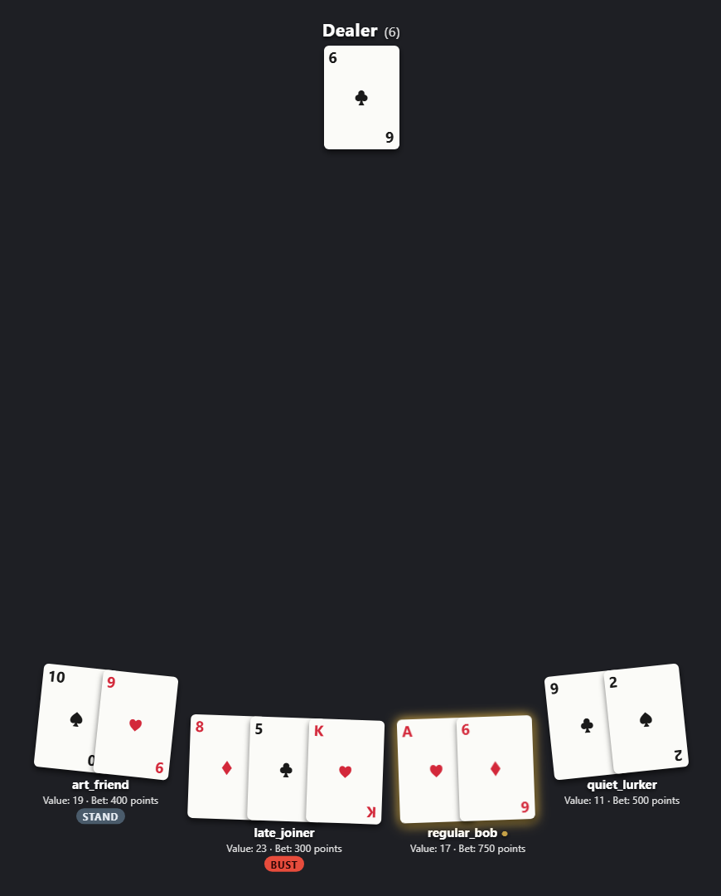
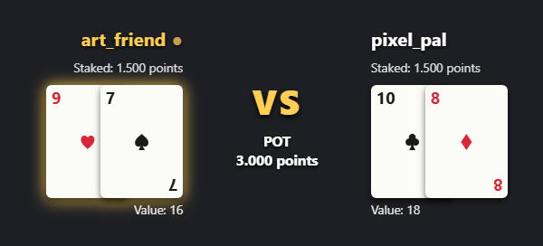
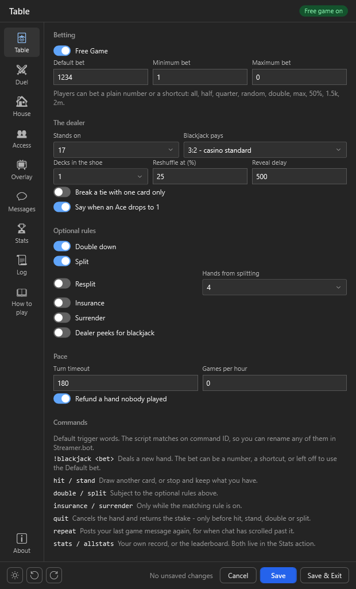
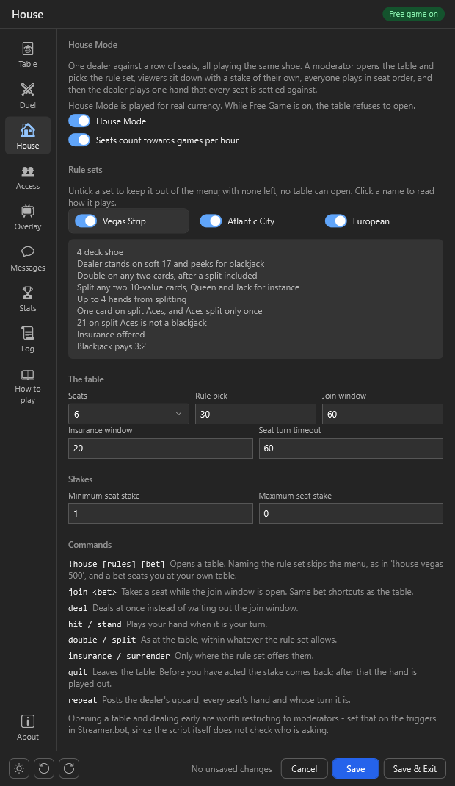

  

<h1 align="center">Blackjack Game</h1>

  <b>Blackjack for your chat — against the dealer, against each other or at a full table.</b> 
  On Twitch, YouTube and Kick, drawn live on stream through OBS.

  
  
  
  
  
  

  <a href="https://github.com/aaskjer/Blackjack-Game/releases"><b>Download</b></a> &nbsp;·&nbsp;
  <a href="Setup-Guide.md"><b>Setup Guide</b></a> &nbsp;·&nbsp;
  <a href="FAQ.md"><b>FAQ</b></a> &nbsp;·&nbsp;
  <a href="Import-String.md"><b>Import String</b></a>

---

## 📖 Overview

Blackjack Game is a chat game for Streamer.bot with three modes on one set of rules. `!blackjack` deals a
hand against the dealer, `!bjduel` puts two chatters head to head, and `!house` seats up to six players
against a single dealer hand. The game answers on whichever platform the command came from.

## ✨ Highlights

- 🃏 **Real table play.** Hit, stand, double, split with resplits, surrender and insurance. Each platform has
  its own shoe of one to eight decks, and played cards stay out until the reshuffle.
- ⚔️ **Duels without the house.** Points move straight from one chatter to the other. A double or a split
  becomes a raise the opponent has to accept, and a tie can go to double-or-nothing sudden death.
- 🏠 **Three casino rule sets.** House Mode plays Vegas Strip, Atlantic City or European rules, each with its
  own deck count, peek, doubling, splitting, insurance and surrender.
- 🎩 **A dealer you configure.** It stands on anything from 16 to 21, peeks if you want it to and breaks ties
  by your rule. Blackjack pays what you set; a 5-card Charlie pays 1.5x, three sevens pay 2x.
- ⏱️ **No hand stays open.** Every deadline runs on its own. An abandoned hand refunds or plays itself out
  instead of waiting for the next chat command.
- 📺 **An overlay with real cards.** Card faces, deal animations, a VS layout for duels, seats curved around
  the dealer and countdown rings on open prompts. It runs as a local file or from a web server, OBS 33
  included.
- 💬 **169 chat lines, 50 stat variables.** Every message is editable with a live preview. Stats live in
  persisted `bjg_*` user variables, and the leaderboard ranks combined lifetime net from table and duels.

  
  

  
  

---

## Credits

- **Author:** [aaskjer on Twitch](https://twitch.tv/aaskjer) · [aaskjer.github.io](https://aaskjer.github.io/)
- **Built for:** [Streamer.bot](https://streamer.bot) by [nate1280](https://www.patreon.com/c/nate1280/home)
- **Works with:** [Currency Core by StreamUP](https://streamup.tips/product/currency-core) · [LOYALTY POINTS by tawmae](https://tawmae.xyz/loyalty-points)
- **Community:** [Blackjack Game on the Streamer.bot Discord](https://discord.com/channels/834650675224248362/1447648588694818836/1447648588694818836)
- **Thanks:** YOU ♡
