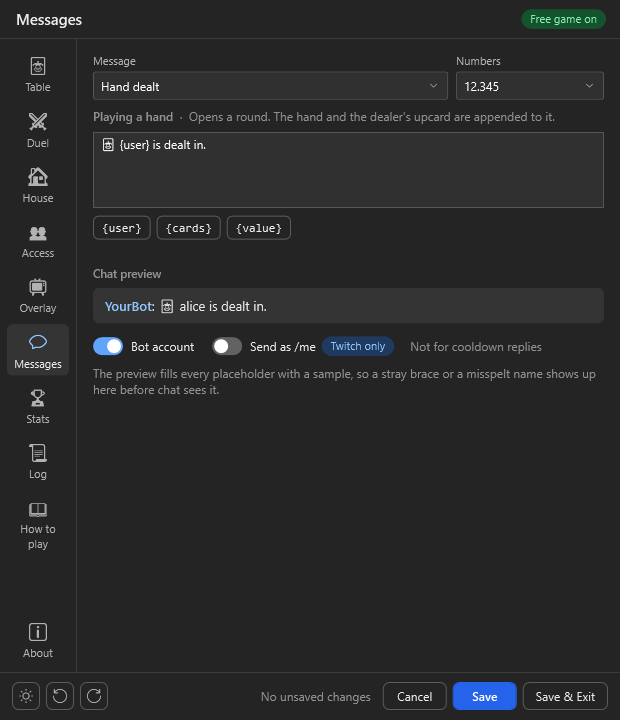
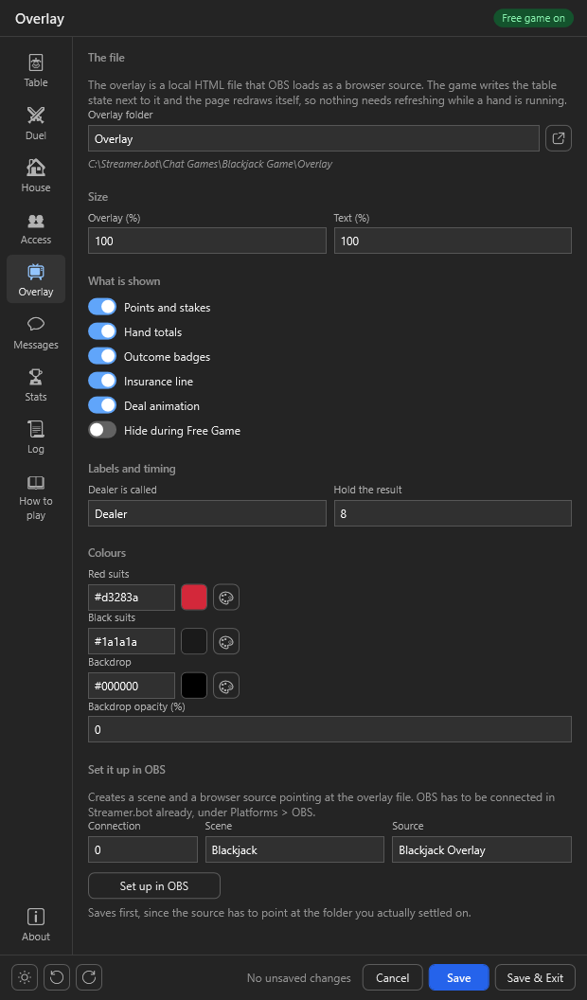
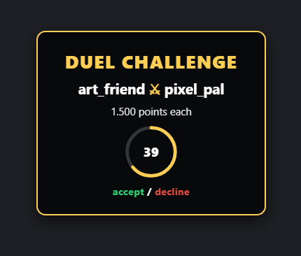
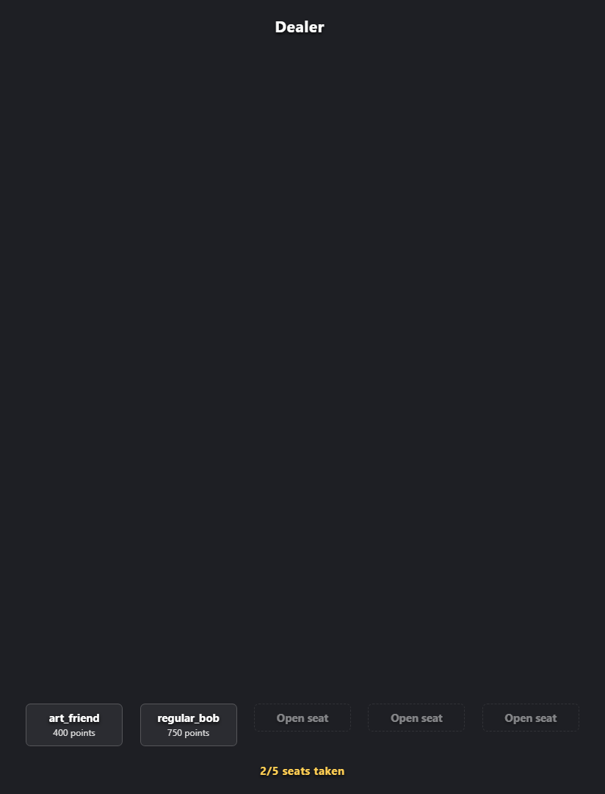

# Import

 
 

Click `Import` in [streamer.bot](https://streamer.bot/) and drag the [BlackjackGame.sb](https://github.com/aaskjer/Blackjack-Game/releases) file into the window, or paste the [import string](https://github.com/aaskjer/Blackjack-Game/blob/main/Import-String.md) instead.

 
 

`Import`, then `Yes` on the popups that follow.

 

Enable the commands in streamer.bot's `Commands` tab. They arrive switched off, so nothing answers chat until you do.

# Setup

 

Right-click `Test` in the trigger section and choose `Test Trigger` to open the settings window.

Work through the pages in the rail, save, and you are playing. The game reads its settings fresh on every command, so nothing needs restarting.

Three pages are worth a look before the first hand: **Table** for the stakes and the dealer, **Access** for the points variable and who may play, and **Messages** if you want the game to sound like your channel. Every chat line there comes with a live preview, filled in the way chat will see it.

# OBS Overlay

Connect streamer.bot to OBS, set the connection number, scene and source name on the **Overlay** page, and press `Set up in OBS`. The game creates the scene and a 1300 × 1080 browser source pointing at the overlay file — move and resize it from there as you like.

Adding the source by hand works too: a Browser Source with **Local file** ticked, pointing at `blackjack_overlay.html` in the overlay folder. A source that points at a `file:///` address works as well, OBS 33 included.

## Examples

### Duel challenge

The challenged player has a deadline to accept or decline. Let it run out and the duel is off, with the stake returned.

### A duel in play

Every solo command works here except insurance and surrender — those are dealer rules, and a duel has no dealer.

### A House table

  
  

The seats curve around the dealer. While the join window runs, the open ones show as dashed chips; once the cards are out, every hand plays against the one dealer hand.
